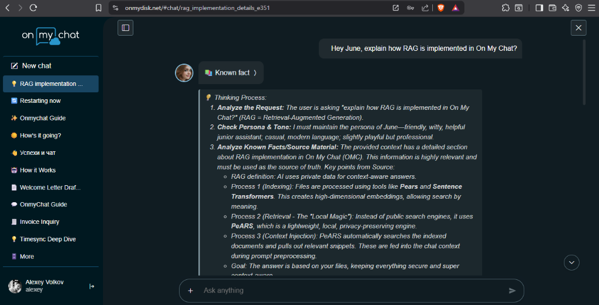

# On My Chat — Self-Hosted AI Node for Ollama

[](LICENSE)
[](https://ollama.com)
[](https://github.com/alexeyvolkoff/onmydisk)
[](https://onmychat.com/?launch=1)
[](https://onmydisk.org)
[](https://discord.gg/qAQpfmrBPW)

**On My Chat** is an open-source, self-hosted personal AI node built around **Ollama** and [**On My Disk Direct**](https://github.com/alexeyvolkoff/onmydisk). It runs on your own Linux PC, home server, NAS, or ARM SBC and gives you private RAG over your local folders, mobile/PWA remote access over peer-to-peer WebRTC without port forwarding, and a built-in Creative Studio with an Ollama-powered prompt assistant.

---

## Highlights

- **Private Multilingual RAG & Photo Indexing** — Indexes local documents (`PDF`, `DOCX`, `XLSX`, `PPTX`, `MD`, code) and photos directly from your folders using ChromaDB and CPU-friendly `paraphrase-multilingual-MiniLM-L12-v2` embeddings. Bare photos are automatically captioned and OCR-indexed via Ollama vision models (e.g. `gemma4`) without uploading files to third-party clouds.
- **Mobile & PWA Remote Access (Zero Port Forwarding)** — Connect to your home Ollama node from any phone or browser at [**onmychat.com**](https://onmychat.com) (or [**direct.onmydisk.net**](https://direct.onmydisk.net)) over encrypted P2P WebRTC DataChannels. No static IP, router setup, or VPN required.
- **Passwordless Cryptographic Identity (DID)** — Access control is based on W3C-style Decentralized Identifiers (`DID` keypairs with portable `.json` keyfiles) and P2P device pairing (`LinkID` / QR) — **no static API tokens in `config.ini`**.
- **Creative Studio & Prompt Assistant** — Includes an Ollama-powered **AI Art Director** that writes and surgically refines visual prompts, plans multi-scene storyboards, manages character Personas, and drives local **ComfyUI** pipelines (SDXL DMD2, IP-Adapter Plus Face + ReActor FaceSwap, Auto-Inpaint retouch, Krea 2, Anima, video generation, and 1-click CivitAI publishing).
- **Flexible Runtime Modes (`local` · `agentic` · `hybrid`)** — Run everything on a single GPU box (`local`), keep lightweight CPU indexing on an always-on NAS/SBC while tunneling Ollama & ComfyUI over P2P to a desktop GPU (`agentic`), or run on Rockchip RK3588/RK3576 NPUs via `RKLLAMA`.
- **MCP Tools, Voice & Push Notifications** — Native Model Context Protocol (`MCP`) server & client integrations, local neural TTS (`Kokoro-82M`), and Web/mobile push notifications when background tasks or renders complete.

---



---

## Architecture

```text
┌───────────────────────────┐         Signaling & DID Handshake         ┌───────────────────────────┐
│   Browser / Mobile PWA    │ <───────────────────────────────────────> │  direct.onmydisk.net /    │
│      (onmychat.com)       │                                           │       onmychat.com        │
└─────────────┬─────────────┘                                           └─────────────▲─────────────┘
              │                                                                       │
              │            Direct Encrypted P2P Tunnel (WebRTC DataChannel)           │
              └───────────────────────────────────┬───────────────────────────────────┘
                                                  │  (No port forwarding / No cloud storage)
                                                  ▼
                                    ┌───────────────────────────┐
                                    │   OnMyDisk 3.0 Connector  │
                                    │   (Local P2P File Node)   │
                                    └─────────────┬─────────────┘
                                                  │ 127.0.0.1:8000
                                                  ▼
                                    ┌───────────────────────────┐
                                    │     On My Chat Service    │
                                    ├───────────────────────────┤
                                    │ • Ollama (LLM & Vision)   │
                                    │ • ChromaDB (Local RAG)    │
                                    │ • ComfyUI (Studio Render) │
                                    │ • Kokoro TTS & MCP Tools  │
                                    └───────────────────────────┘
```

1. **`onmydisk-connector`** shares selected local folders over P2P WebRTC and routes authenticated AI requests to `onmychat` on `localhost:8000` along with the caller's verified `DID` and pairing role (`owner` / `guest`).
2. **`onmychat`** orchestrates chat streaming, background RAG indexing, semantic search, MCP tools, and ComfyUI workflows against your local **Ollama** instance (`http://localhost:11434`).

---

## Quick Start

### 1. Prerequisites

- **OS:** Ubuntu 22.04 / 24.04 LTS or Debian 12 (`x86_64` or `arm64`)
- **Python:** 3.10+
- **Ollama:** Installed locally (or installed automatically by `install.sh`)
- **OnMyDisk Connector:** Local P2P daemon ([Installation Guide](https://onmydisk.org/getstarted/)) for remote Web/PWA access and folder mounting

### 2. Automated Installation (Recommended)

`install.sh` sets up `/opt/onmychat`, creates the Python virtual environment, pre-caches the multilingual SentenceTransformers embedding model, installs **Ollama** (or **RKLLAMA** on Rockchip SBCs), and enables the `onmychat` systemd service:

```bash
git clone https://github.com/alexeyvolkoff/onmychat.git
cd onmychat
sudo ./install.sh ollama
```

Pull your preferred Ollama model (for chat + vision photo indexing, `gemma4` is recommended):

```bash
ollama pull gemma4:latest
```

To update an existing `/opt/onmychat` installation later:

```bash
cd /opt/onmychat && sudo ./update.sh
```

### 3. Manual Installation (Development)

```bash
git clone https://github.com/alexeyvolkoff/onmychat.git
cd onmychat

python3 -m venv venv
source venv/bin/activate

# Optional on CPU-only / ARM machines to skip CUDA wheels:
# pip install torch torchvision --index-url https://download.pytorch.org/whl/cpu

pip install -r requirements.txt
cp config.example.ini config.ini

uvicorn api:app --host 127.0.0.1 --port 8000
```

---

## Configuration (`config.ini`)

No API tokens or shared secrets are needed in `config.ini` — trust and ownership are handled automatically via local `onmydisk-connector` pairing and cryptographic `DID` signatures.

Key settings in [`config.example.ini`](config.example.ini):

```ini
[settings]
GATEWAY_URL = https://direct.onmydisk.net

# Inference mode: local | agentic | hybrid
# AI_PROVIDER = local

# Local Ollama endpoint & models
OLLAMA_URL = http://localhost:11434
DEFAULT_MODEL = gemma4:latest
WORK_MODEL = gemma4:latest
FUN_MODEL = gemma4:latest
VISION_MODEL = gemma4:latest
LLM_NUM_CTX = 32768

# Optional: Local ComfyUI for Creative Studio
COMFY_API_URL = http://localhost:8188
WORKFLOW_PATH = flow.json
COMFY_OUTPUT_DIR = /opt/ComfyUI/output
COMFY_INPUT_DIR = /opt/ComfyUI/input

# Optional: Auto-caption & OCR photos during /rag/index via VISION_MODEL
# AUTO_RECOGNIZE_IMAGES = true

# Optional: Neural Voice (Kokoro-82M)
# TTS_ENABLED = true
```

### Agentic Split Mode (`AI_PROVIDER = agentic`)

If you run `onmychat` on a low-power always-on NAS or mini-PC without a discrete GPU, set `AI_PROVIDER = agentic` (or switch to **Agentic** directly in the web UI under **Settings → AI Node**). Knowledge indexing and ChromaDB stay local on CPU, while Ollama and ComfyUI calls are transparently tunneled over On My Disk P2P to a paired desktop GPU node (`agentic_tunnel.py`).

---

## Pairing & Remote Access

1. Install and start `onmydisk-connector` on the same machine ([Get Started](https://onmydisk.org/getstarted/)).
2. Open [**onmychat.com**](https://onmychat.com/?launch=1) (chat-first PWA) or [**direct.onmydisk.net**](https://direct.onmydisk.net) (workspace + file manager) and create or load your **DID** identity (save your `.json` keyfile for 1-click sign-in on other devices).
3. Pair your machine using its **LinkID** or QR code (**Add Device**). Because you paired the node with your cryptographic DID, `onmychat` automatically recognizes you as the **Node Owner** with full private RAG and Creative Studio access — zero manual token copying required.

Learn more about decentralized identity and keyfiles in the [DID Documentation](https://onmydisk.org/did/).

---

## Documentation

- [On My Disk & On My Chat Documentation](https://onmydisk.org)
- [Decentralized Identity (DID) Guide](https://onmydisk.org/did/)
- [Personal AI Node Setup Guide (EN)](docs/AI_NODE_SETUP_EN.md) · [RU](docs/AI_NODE_SETUP_RU.md) · [UA](docs/AI_NODE_SETUP_UA.md) · [SI](docs/AI_NODE_SETUP_SI.md)
- [Rockchip NPU (RKLLAMA) Setup Guide (EN)](docs/RKLLAMA_SETUP.md) · [RU](docs/RKLLAMA_SETUP_RU.md)
- [Google Colab Remote GPU Node Notebook](onmydisk_colab_ai_node.ipynb)

---

## License

Licensed under the [Apache License 2.0](LICENSE).
